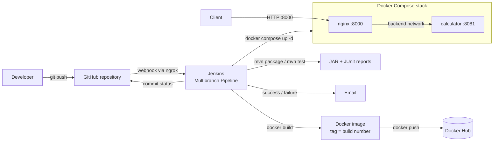

# calculator-devops

[](https://hub.docker.com/r/kavyag3011/calculator-devops)


Calculator REST API built with Java 21, Spring Boot and Maven, deployed through a CI/CD pipeline using GitHub, Jenkins, Docker and Docker Compose.

```
GitHub (webhook) -> Jenkins -> Maven build and test -> Docker image -> Docker Hub -> Docker Compose (Nginx + API)
```

## Contents

- [Architecture](#architecture)
- [Tech stack](#tech-stack)
- [Build and test](#build-and-test)
- [Run locally](#run-locally)
- [Run with Docker](#run-with-docker)
- [Deploy with Docker Compose](#deploy-with-docker-compose)
- [CI/CD pipeline](#cicd-pipeline)
- [API](#api)
- [Git workflow](#git-workflow)
- [Project structure](#project-structure)

## Architecture



## Tech stack

| Area | Tools |
|---|---|
| Application | Java 21, Spring Boot 3.5, Spring Web, Spring Boot Actuator, Maven |
| Testing | JUnit 5 (parameterized tests), Spring MockMvc, AssertJ |
| Version control | Git, GitHub (issues, project board, pull requests, branch protection) |
| CI/CD | Jenkins Multibranch Pipeline, declarative `Jenkinsfile`, GitHub webhook |
| Containers | Docker (multi-stage build), Docker Hub |
| Deployment | Docker Compose, Nginx reverse proxy |

## Build and test

Requires JDK 21 and Maven 3.6.3 or newer.

```bash
mvn clean package        # compile, run all tests, build target/calculator.jar
mvn test                 # run tests only
```

36 tests run in three classes:

| Class | Type | Covers |
|---|---|---|
| `CalculatorServiceTest` | unit | every operation with several inputs, division by zero |
| `CalculatorControllerTest` | MockMvc (`@WebMvcTest`) | JSON responses and every 400 error case |
| `CalculatorApplicationTests` | full context (`@SpringBootTest`) | application start-up, health, liveness and readiness endpoints |

Test reports (JUnit XML) are written to `target/surefire-reports/`.

## Run locally

```bash
java -jar target/calculator.jar
```

The API listens on port **8081** by default. Set `SERVER_PORT` to use a different port:

```bash
SERVER_PORT=9090 java -jar target/calculator.jar
```

## Run with Docker

The image is published on Docker Hub: [kavyag3011/calculator-devops](https://hub.docker.com/r/kavyag3011/calculator-devops). Images built from `main` are tagged with the Jenkins build number and `latest`.

```bash
docker run -d --name calculator -p 8081:8081 kavyag3011/calculator-devops:latest
curl "http://localhost:8081/api/v1/add?a=2&b=3"
```

Build the image locally:

```bash
docker build -t kavyag3011/calculator-devops:dev .
```

The `Dockerfile` uses two stages: a Maven/JDK stage that builds the JAR (dependencies are downloaded in their own cached layer) and a `eclipse-temurin:21-jre-alpine` runtime stage that contains only the JAR. The container runs as the non-root user `app`, exposes port 8081 and has a health check on `/actuator/health`.

## Deploy with Docker Compose

The stack runs the API behind an Nginx reverse proxy:

```
client --:8000--> nginx --(backend network)--> calculator:8081
```

```bash
docker compose up -d          # start (builds the image if it is missing)
docker compose ps             # both services should show (healthy)
curl "http://localhost:8000/api/v1/add?a=2&b=3"
docker compose logs -f        # follow logs
docker compose down           # stop and remove containers and networks
```

| Service | Image | Notes |
|---|---|---|
| `calculator` | `kavyag3011/calculator-devops` | Not published to the host; reachable only through Nginx. Health check on `/actuator/health`, `restart: unless-stopped`. |
| `nginx` | `nginx:1.27-alpine` | Published on port 8000. Forwards `/api/` and `/actuator/health`; everything else returns 404. Starts after the API is healthy. |

The `backend` network is `internal`, so the API container has no route to the host or the internet. Nginx re-resolves the `calculator` service name every 10 seconds, so a redeployed container is picked up without restarting Nginx.

Configuration is read from environment variables (defaults in brackets). Copy `.env.example` to `.env` to override them:

| Variable | Purpose |
|---|---|
| `IMAGE_NAME` | Calculator image name (`kavyag3011/calculator-devops`) |
| `IMAGE_TAG` | Calculator image tag (`dev`) |
| `NGINX_PORT` | Host port for Nginx (`8000`) |

## CI/CD pipeline

The pipeline is defined in the [`Jenkinsfile`](Jenkinsfile) and runs as a Jenkins **Multibranch Pipeline**. A GitHub webhook (exposed through ngrok) starts a build on every push and pull request, and Jenkins reports the result back to GitHub as a commit status.

| Stage | Runs on | What it does |
|---|---|---|
| Checkout | all branches and PRs | `checkout scm`, records the short commit ID |
| Build | all branches and PRs | `mvn clean package -DskipTests` |
| Test | all branches and PRs | `mvn test`, publishes the JUnit XML; a failing test fails the build |
| Docker Build | all branches and PRs | builds `kavyag3011/calculator-devops:<tag>`; on `main` the tag is the build number |
| Push | `main` only | pushes `<build number>` and `latest` to Docker Hub using the `DockerHubCred` credential |
| Deploy | `main` only | `docker compose up -d` from a fixed deploy directory, waits until `/actuator/health` reports `UP`, checks the running image tag, calls the API |

Post actions send a success or failure email and clean the workspace.

The deployment is idempotent: Compose uses the fixed project name `calculator`, recreates only services whose image or configuration changed, and a second run of the same build leaves the running containers untouched.

### Jenkins setup

| Item | Value |
|---|---|
| Job type | Multibranch Pipeline, GitHub branch source, discovers branches and pull requests from origin |
| Trigger | GitHub webhook to `/github-webhook/`; periodic scan every hour as a fallback |
| Credentials | `DockerHubCred` (Docker Hub access token), `github-pat` (repository scanning), `github-pat-secret` (GitHub server, commit status) |
| Plugins | Pipeline, Git, GitHub, GitHub Branch Source, Docker Pipeline, JUnit, Credentials Binding, Mailer, Pipeline: Stage View, Workspace Cleanup |
| Agent | built-in node; the `jenkins` user is a member of the `docker` group |

`main` is protected: changes go through pull requests, conversations must be resolved, and the `continuous-integration/jenkins/pr-head` check must pass before merging.

## API

All endpoints take two numeric query parameters, `a` and `b`, and return JSON.

| Operation | Endpoint | Example |
|---|---|---|
| Add | `GET /api/v1/add?a=&b=` | `/api/v1/add?a=2&b=3` |
| Subtract | `GET /api/v1/subtract?a=&b=` | `/api/v1/subtract?a=10&b=4.5` |
| Multiply | `GET /api/v1/multiply?a=&b=` | `/api/v1/multiply?a=2.5&b=4` |
| Divide | `GET /api/v1/divide?a=&b=` | `/api/v1/divide?a=7&b=2` |
| Health | `GET /actuator/health` | `UP` / `DOWN` |

### Successful response

```bash
curl "http://localhost:8000/api/v1/add?a=2&b=3"
```

```json
{"operation":"add","a":2,"b":3,"result":5}
```

Calculations use `BigDecimal`, so decimal results are exact (`0.1 + 0.2 = 0.3`). Division is rounded to 16 significant digits.

### Error response

Invalid requests return HTTP **400** with a JSON body:

```bash
curl "http://localhost:8000/api/v1/divide?a=1&b=0"
```

```json
{"timestamp":"2026-10-28T09:52:03.078Z","status":400,"error":"Bad Request","message":"Division by zero is not allowed","path":"/api/v1/divide"}
```

| Case | Example | Message |
|---|---|---|
| Division by zero | `divide?a=1&b=0` | `Division by zero is not allowed` |
| Missing parameter | `add?a=5` | `Required parameter 'b' is missing` |
| Not a number | `add?a=abc&b=3` | `Parameter 'a' must be a number, but was 'abc'` |
| NaN / Infinity | `add?a=NaN&b=1` | `Parameter 'a' must be a number, but was 'NaN'` |

### Health

| Endpoint | Purpose |
|---|---|
| `/actuator/health` | Overall application health |
| `/actuator/health/liveness` | Process is running |
| `/actuator/health/readiness` | Ready to accept traffic |

## Git workflow

- Every piece of work starts as an issue on the project board and is done on its own branch (`feature/…`, `docs/…`, `refactor/…`).
- Changes reach `main` only through pull requests that close their issue (`Closes #N`).
- Commit messages follow the `type: description` format (`feat`, `fix`, `test`, `docs`, `build`, `ci`, `chore`, `refactor`).
- Pull requests were merged with all three strategies (merge commit, squash, rebase) depending on the change.

## Project structure

```
.
├── Dockerfile                  multi-stage image build
├── .dockerignore
├── docker-compose.yml          calculator + nginx stack
├── nginx/nginx.conf            reverse proxy configuration
├── .env.example                Compose variables
├── Jenkinsfile                 CI/CD pipeline
├── pom.xml
├── src/main/java/com/kavyagupta/calculator/
│   ├── CalculatorApplication.java        entry point
│   ├── controller/CalculatorController   REST endpoints
│   ├── service/CalculatorService         arithmetic
│   ├── dto/                              CalculationResponse, ErrorResponse
│   └── exception/GlobalExceptionHandler  maps errors to HTTP 400
└── src/test/java/com/kavyagupta/calculator/
    ├── service/CalculatorServiceTest         unit tests
    ├── controller/CalculatorControllerTest   MockMvc tests
    └── CalculatorApplicationTests            full context + health checks
```

## Author

Kavya Gupta ([@kavyagupta3011](https://github.com/kavyagupta3011))
